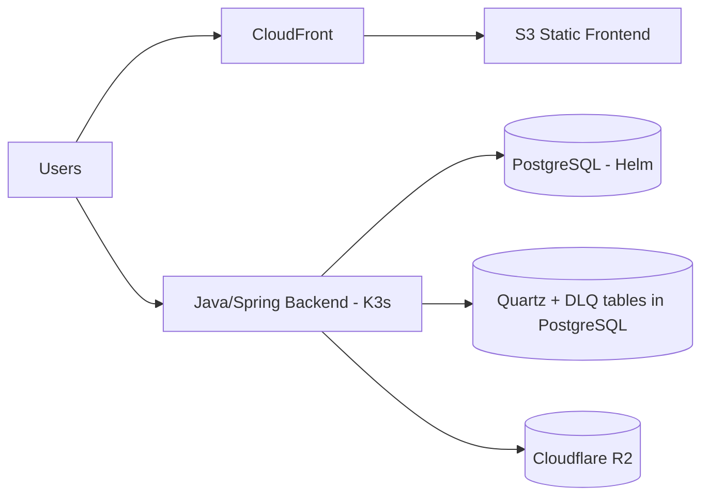

# 001 Technology Architecture

**Last Updated**: 2026-10-18  
**Lifecycle**: MVP

---

## Purpose
Define the approved technology stack, runtime environments, deployment model, and operational standards for YACC MVP.

> **Java migration note (SPEC-002)**: The backend is the Java/Spring service (`services/backend-java`); ADRs 023–030 are Accepted and implemented through Phase 6. The Node/TypeScript packages (`packages/backend`, `@yacc/common`) still exist in the repo and remain built until decommissioning (MIG-080, #364) — they are **transitional**. The frozen `.docs/migration/{openapi.yaml,asyncapi.yaml,schemas/*}` is the API contract source of truth (ADR-023).

## Technology Standards (MVP)
### Runtime & Frameworks
- Backend: Java 21 + Spring Boot (`services/backend-java`, ADR-024). The Node.js/Express POC backend is transitional until MIG-080.
- Frontend: React 18, TanStack Start

### Data & Messaging
- Database: PostgreSQL 15 (FTS for search), Flyway-managed schema + JPA (ADR-027)
- Async / Queue: Quartz + PostgreSQL DB DLQ (ADR-028 — Redis dropped)

### Storage
- Object storage: Cloudflare R2 (attachments + raw payloads)

### Real-time
- WebSockets: raw Spring WebSocket — no Socket.io/STOMP/SockJS/broker; `{event,data,timestamp}` envelope (ADR-026)

### Auth
- Spring Security with dual-role OIDC (RP + embedded Authorization Server), deterministic bootstrap + founder-controlled recovery (ADR-025; supersedes BetterAuth)

### Tooling
- Monorepo: pnpm workspaces + Turborepo (Node/pnpm tooling remains for the frontend and transitional Node packages until MIG-080)
- Tests: Backend — JUnit 5 + Testcontainers; Frontend — Vitest (unit), Playwright (E2E)

## Deployment Architecture (MVP)
### Targets
- Frontend: AWS S3 + CloudFront
- Backend: K3s (Kubernetes) cluster

### Delivery / CI/CD
- Deployment target: K3s
- Installer: Helm (application charts + dependencies)
- Reference: ADR-019 (pod envelope amended by ADR-029)

### Mermaid – High-Level Deployment

## Observability (MVP)
- Structured JSON logging via SLF4J/logback with MDC correlationId; Micrometer metrics scraped at `/actuator/prometheus` (ADR-029; field-shape parity with the Pino-era baseline)
- SLO reference: `.docs/observability-slo.md`

## Forbidden / Deferred (Post-MVP)
- Multi-tenant architecture (deferred)
- Secrets vault integration (deferred)

## References
- ADR-004 logging strategy: `.docs/adr/ADR-004-logging-strategy.md` (amended by ADR-029 for the JVM service)
- ADR-005 config/infrastructure pattern: `.docs/adr/ADR-005-infrastructure-config-pattern.md` (Node-era; transitional until MIG-080)
- ADR-019 K3s + Helm CI/CD target: `.docs/adr/ADR-019-k3s-helm-cicd-deployment.md`
- ADR-024/026/027/028/029: Java replacement architecture, raw WebSocket, data access, async processing, JVM envelope + observability
