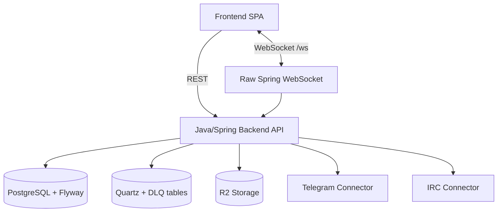

# 002 Application Architecture

**Last Updated**: 2026-10-18  
**Lifecycle**: MVP

---

## Purpose
Document application boundaries, responsibilities, and integration patterns for YACC MVP.

> **Java migration note (SPEC-002)**: The backend application is the Java/Spring service (`services/backend-java`); the Node/TypeScript backend (`packages/backend`) is **transitional** until decommissioning (MIG-080, #364).

## Application Inventory
### 1. Frontend SPA (`packages/frontend/`)
- TanStack Start + React UI
- Uses REST for CRUD and WebSockets for real-time updates

### 2. Backend API (`services/backend-java/` — Java 21 + Spring Boot)
- Spring MVC REST API per the frozen OpenAPI contract (`.docs/migration/openapi.yaml`, ADR-023)
- Raw Spring WebSocket real-time channel (`/ws`, `{event,data,timestamp}` envelope; ADR-026)
- Package layout per amended ADR-030 / ARCH-004 §1: standalone API modules `com.yacc.api.<feature>` (`auth`, `user`, `conversation`, `message`, `note`, `tag`, `routingrule`, `notification`, `audit`, `dlq`, `queue`, `integration`, `realtime`, `connector`) each owning its controllers + wire DTOs, plus the shared planes `entity` (JPA), `repository` (Spring Data), and `service` (genuinely shared/persistence services), with `config` and `common` supporting packages and `com.yacc.YaccApplication` at the root
- Cross-feature access composes through the owning module's public service API (ARCH-004 §1); no mandatory layer skeleton
- Async processing via Quartz + PostgreSQL DLQ (ADR-028); connectors for Telegram and IRC in `api.connector`

### 3. Shared Package (`packages/common/`) — **transitional until MIG-080**
- Shared types/schemas used by the Node-era packages and frontend; not the contract source of truth (superseded by ADR-023)

## Integration Patterns
- Client to Backend: REST + raw WebSocket (envelope-framed events)
- Backend to Data stores: PostgreSQL (Quartz job-store, DLQ and WS-backlog tables included) + R2
- Backend to External platforms: Telegram API, IRC networks (connectors)

## Mermaid – Component View

## Ownership / Lifecycle
- Single-tenant MVP
- Phase 1 + Phase 2 features implemented; SPEC-002 Phases 0–6 merged (Phase 7–8 cutover/decommission pending)
- Post-MVP enhancements tracked via ADR/GOV and product backlog

## References
- Core docs: `.docs/01-product-specification.md`, `.docs/03-implementation-guide.md`
- Java backend guardrails: `.docs/architecture/004-java-backend-guardrails.md`
