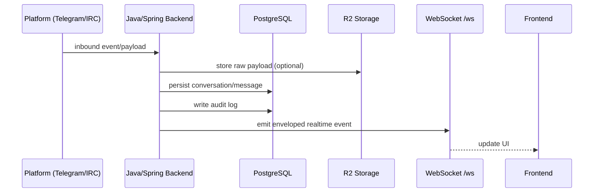

# 003 Data Architecture

**Last Updated**: 2026-10-18  
**Lifecycle**: MVP

---

## Purpose
Define data domains, storage locations, access patterns, and retention expectations for YACC MVP.

## Data Domains (MVP)
- Identity & Access: users, roles, sessions
- Inbox / Conversations: conversations, messages, assignments
- Collaboration: tags, notes
- Rules & Automation: routing rules, rule executions
- Notifications: in-app notifications
- Audit: audit log entries
- Files: attachments, raw payload snapshots
- Async / Real-time durability: dead_letter_queue, websocket_backlog, Quartz job-store tables

## Stores
### PostgreSQL 15 (ADR-027)
Primary system of record for all application state. Schema is managed exclusively by Flyway migrations (`services/backend-java/src/main/resources/db/migration`, V1 baseline onward — no auto-DDL); access goes through JPA entities (`com.yacc.entity`) and Spring Data repositories (`com.yacc.repository`). This includes the `dead_letter_queue` table (ADR-028 DB DLQ), the `websocket_backlog` replay table (ADR-028 re-homed the WS backlog from Redis to PostgreSQL), and the Quartz JDBC job-store tables that drive the retry worker.

### Cloudflare R2
- Attachments (inbound re-host + outbound uploads)
- Raw inbound payload storage (debug)

> **Redis is removed** (ADR-028): queue scheduling/retry tracking runs on Quartz with the PostgreSQL job store; there is no Redis dependency, pod, or `REDIS_URL` in the current architecture.

## Access Patterns
- Frontend accesses data only via Backend API (REST/WebSocket), not direct DB access.
- External integrations write inbound data via backend connectors.
- Wire contracts are the frozen `.docs/migration/{openapi.yaml,asyncapi.yaml,schemas/*}` (ADR-023); Zod schemas in `@yacc/common` are a transitional Node-era validation layer, not the contract source.

## Retention (MVP defaults)
- Audit logs: 1 year (configurable)
- Raw payloads: 7 days (configurable)
- DLQ rows: 7 days (auto-cleanup via scheduled job)

## Mermaid – Data Flow (Inbound Message)

## References
- Data model: `.docs/02-api-and-data-model.md`
- Data access decisions: `.docs/adr/ADR-027-data-access-flyway-jpa-encryption.md`
- Async/DLQ decisions: `.docs/adr/ADR-028-async-processing-quartz-db-dlq.md`
